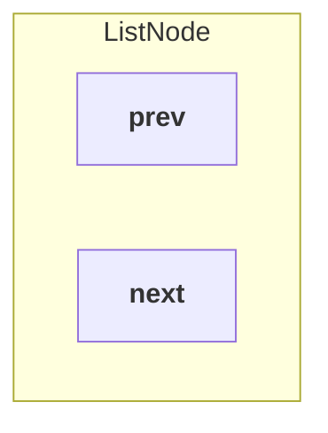
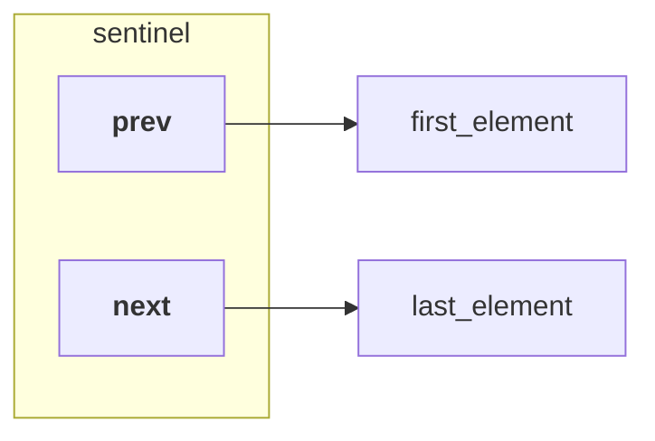
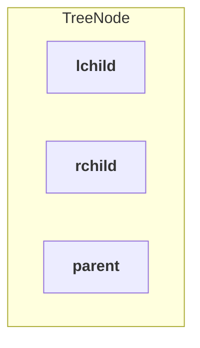
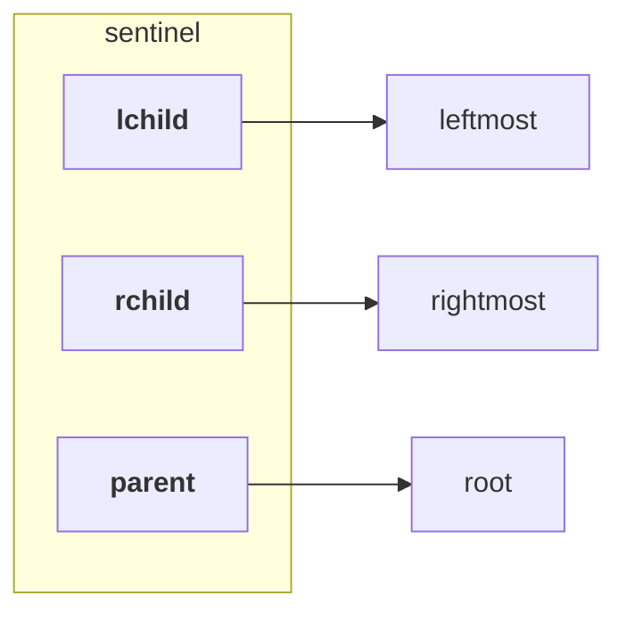

# 链表

## 节点设计

我们这里的链表指的是双链表，节点有两个个部分构成。



## 哨兵节点

我们引入了一个哨兵节点，类型也是 `ListNode` 在一个非空的链表中，其指针指向如下：



## 算法实现

## 侵入式容器 VS 非侵入式容器

对于侵入式容器来说，容器并不会管理对象的生命周期，所有的节点仅仅是通过内部的指针进行连接。一般需要手动计算偏移量，比如 `offsetof`。在 `C++` 中，我们可以使用 `std::meta::info` 计算偏移量。

```c
#define offsetof(TYPE, MEMBER) ((size_t)&((TYPE *)0)->MEMBER)

// 参与循环GC的对象头部
typedef struct _gc_head
{
    struct _gc_head *gc_next;
    struct _gc_head *gc_prev;
    int gc_refs;
} PyGC_Head;

// 带GC的对象：PyGC_Head 在最前面，后面才是PyObject
typedef struct _gc_object
{
    PyGC_Head gc_head;
    Py_ssize_t ob_refcnt;
    struct _typeobject *ob_type;
} PyObject_GC;
```

对于非侵入式容器，我们的树节点使用继承的方式添加新的字段：

```cpp

template <typename T>
class Node : public ListNode
{
    T value;
};

```

对于非侵入式容器来说，容器会自行处理节点生命周期。

```cpp
class ListNode
{
    // ...
};

template <typename T>
class Node : public ListNode
{
    T value;
};
```

所有操作和算法依旧是围绕 `ListNode` 进行，如果需要用到 `value`，可以直接进行类型转换（`static_cast`）。


## 迭代器设计

```cpp

class ListIterator
{
    // using value_type = ...;
    // 一些其他标准要求提供的类型别名

    ListNode* current;
};

```

无论是哪种容器，我们的迭代器内部只会存储最基础的指针。

# 二叉树

## 节点设计

我们的节点有三个部分构成



实现类似以下，为了简化，我们在这里：

- 只展示 `non-const` 的版本。
- 忽略繁琐的语法，比如 `constexpr` 等关键字。

```cpp
class TreeNode
{
    TreeNode* links[3];

    // 修改成员字段
    void parent(TreeNode* node) { links[2] = node; }
    
    // 访问成员字段
    auto& parent() { return links[2]; }

    // 将所有的 links 赋值为 node
    void reset(TreeNode* node);
    
    TreeNode* maximum();

    TreeNode* maximum();

    TreeNode* increment();

    TreeNode* decrement();

    void rotate_left();
    
    void rotate_right();
};
```

成员字段的修改和访问我们只展示了 `parent` 部分，总共如下：

- parent 父节点
- lchild 左孩子
- rchild 右孩子

一些基本的方法在工业界都有很成熟的实现，这里只给出声明。

## 哨兵节点

我们引入了一个哨兵节点，类型也是 `TreeNode` 在一个非空的树中，其指针指向如下：



在实现层面，我们为 `TreeNode` 提供了一些其他的接口方便实现树结构。

```cpp

class TreeNode
{
    // Some Implementation...

    // 哨兵节点调用，用于和普通节点区分
    void as_sentinel();

    // 判断一个节点是否是哨兵节点
    bool as_sentinel() const;

    // 将当前节点连接到 pa 上，并且维护 sentinel。
    void link(bool insert_left, TreeNode* pa, TreeNode& sentinel);

    // 将当前节点从树中断开，并且维护 sentinel。
    void unlink(TreeNode& sentinel);
}; 
```

需要注意的是，并不是所有的树的 `is_sentinel` 和 `as_sentinel` 都是有效的，我们不会为每种树的节点单独引入一个字段用去区分，目前有效的是：

- **AVLTree** 节点引入高度，其中哨兵节点的高度为 $-1$。
- **RedBlackTree** 节点引入第三种颜色，其中哨兵节点颜色为第三种颜色。
- **Treap** 节点引入高度优先级，其中哨兵节点的优先级是一个特殊值。
 
## 算法实现

我们采用的算法都是主流实现，在相关工程代码和教材中都可以找到。

目前主流的迭代器实现中可能会存在陷入死循环的代码，比如：

```cpp
std::set<int>().begin()++;
```

为了避免，我们引入 `is_sentinel` 和 `as_sentinel`，这样可以让二叉树的迭代器循环工作，即对 `end()` 进行自增，可以让迭代器回到树的第一个节点的位置。

## 侵入式容器 VS 非侵入式容器

参考链表。


## 迭代器设计

参考链表。


